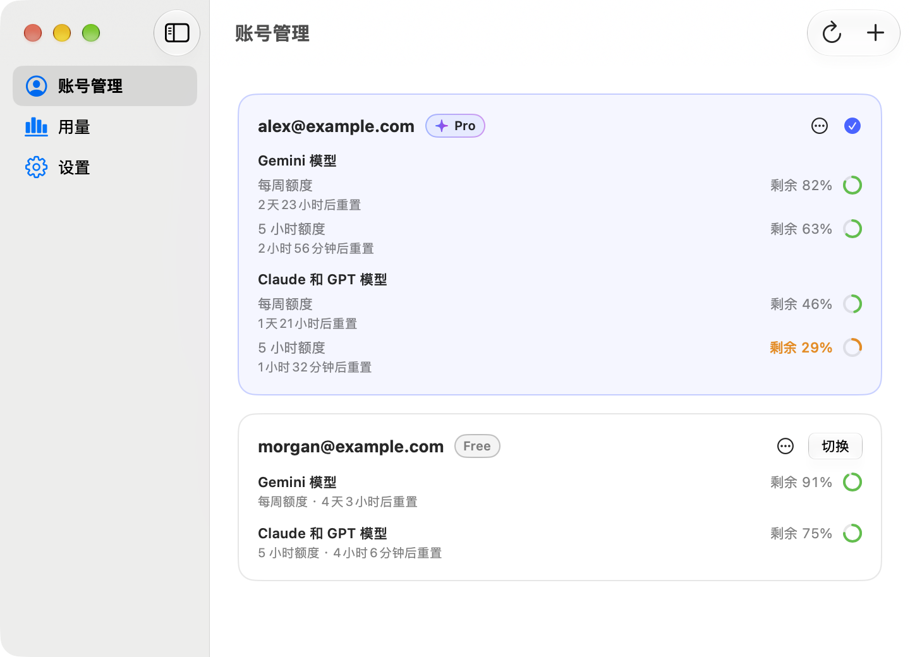
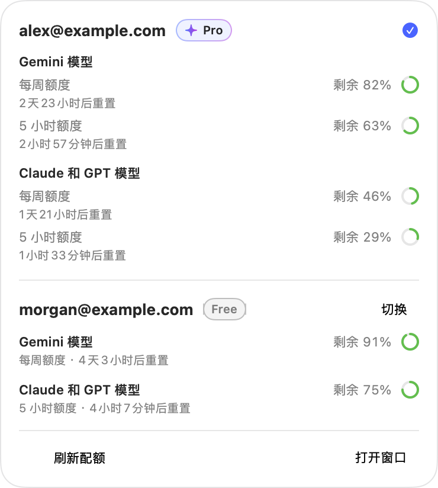
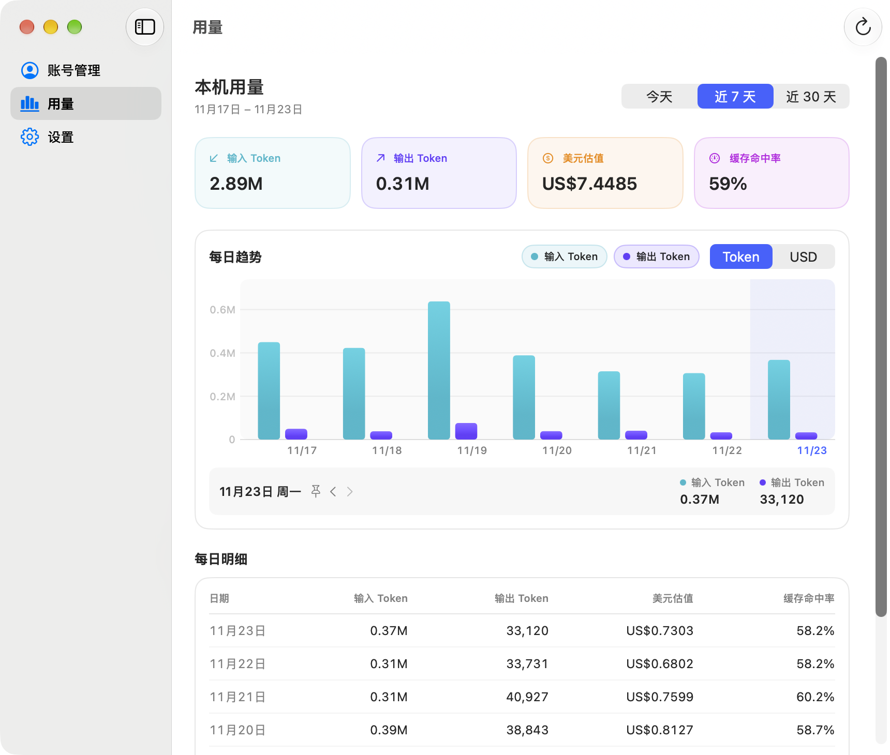

<p align="center">
  
</p>
<h1 align="center">AGY Switcher</h1>
<p align="center">Switch Google accounts for Antigravity and agy from the macOS menu bar, check quotas, and track local usage.</p>
<p align="center"><a href="README.md">简体中文</a> · <strong>English</strong></p>
<p align="center">
  <a href="#installation">Installation</a> ·
  <a href="#quick-start">Quick start</a> ·
  <a href="#screenshots">Screenshots</a> ·
  <a href="#build-from-source">Build from source</a>
</p>

## Installation

AGY Switcher requires **macOS 26 or later**. Choose the installer for your Mac. [GitHub Releases](https://github.com/tyuan511/agy-switcher/releases)

| Chip | Installer |
| --- | --- |
| Apple Silicon | `AGY-Switcher-v*-macOS-arm64.dmg` |
| Intel | `AGY-Switcher-v*-macOS-amd64.dmg` |

Open the DMG and drag **AGY Switcher** into Applications. You can also [build from source](#build-from-source).

v0.1.0 ships as a universal installer. To upgrade from v0.1.0 to a release with separate installers, download the matching DMG and install it manually once. Future in-app updates select the matching installer automatically.

### In-app updates

Release builds check GitHub Releases after launch and every 24 hours while running. When a newer stable version is available, the menu bar shows an update option. Open **Settings → Software update** to check manually and read release notes in English or Simplified Chinese. **Download and Restart** verifies the DMG's signature and notarization, then checks the enclosed app's signature, bundle ID, and version before replacing the current app and restarting. Install the app in an Applications folder you can write to.

## Quick start

1. Open AGY Switcher and click **+** in the upper-right corner of **Accounts**. Use your default browser to authorize a personal Google account with Antigravity access. Repeat for each account you want to add.
2. Open **Accounts** or the menu bar panel to see the active account, each model group's remaining quota, and when it resets. You can refresh manually or have the app refresh stale quotas when you open either view.
3. Click **Switch** next to the account you want to use. If Antigravity is running, AGY Switcher attempts to restart it. Restart `agy` in your terminal to start a session with the new account.
4. Open **Usage** to see input and output token counts, daily trends, estimated costs in USD, and the cache hit rate for the last 7 or 30 days. Usage comes from local Antigravity and `agy` sessions saved on this Mac.

In **Settings**, you can switch between Simplified Chinese and English, change the appearance, the window-close behavior, and the quota refresh interval, start the app at login, or hide the Dock icon. **Export & Import** saves every account with its sign-in credentials into a passphrase-encrypted `.agyaccounts` backup, which can be imported on another device; accounts that already exist remain unchanged.

## Screenshots

The screenshots show the Simplified Chinese interface with fictional email addresses, plans, quotas, and usage.

### Accounts



### Menu bar



### Usage



## Account and usage data

- Google authorization takes place in your browser. AGY Switcher stores tokens for added accounts in the macOS Keychain. Switching accounts updates the shared Keychain entry and local fallback credentials used by Antigravity and `agy`. macOS may ask for permission to access the shared entry.
- **Usage** reads local Antigravity and `agy` SQLite session records on this Mac and aggregates input and output tokens and cache hits by day. The page notes any sessions it couldn't read.
- Cost estimates use Google Cloud's global Standard Model rates and are for reference only — check your bill for actual charges. Some models have no estimate yet. [Google Cloud model pricing](https://cloud.google.com/model-garden/pricing) [Partner model pricing](https://cloud.google.com/model-garden/partner-models/pricing)

> [!NOTE]
> The app is designed for personal accounts that use the default Google sign-in. Quota reporting and account switching depend on the clients' interfaces and credential formats. The initial compatibility targets were Antigravity 2.34.0 and agy 1.5.12.

## Build from source

Use Xcode 26 or later. Run the unit tests and build the Debug app from the repository root.

```sh
swift test
xcodebuild -project AGYSwitcher.xcodeproj -scheme AGYSwitcher -configuration Debug \
  -destination 'platform=macOS' -derivedDataPath DerivedData \
  CODE_SIGN_IDENTITY=- DEVELOPMENT_TEAM= build
```

The build produces `DerivedData/Build/Products/Debug/AGY Switcher.app`. The command uses ad hoc signing and works without a Developer ID certificate.

<details>
<summary>Manual checks</summary>

1. Add two Google accounts with Antigravity access. Check the model groups, remaining quotas, and reset countdowns for both accounts.
2. With Antigravity running, switch accounts from the menu bar. Confirm that Antigravity restarts, then check the account in the desktop app and in a fresh `agy` process. Use `/usage` in `agy` to compare quotas.
3. Close the main window, reopen **Accounts** from the menu bar, and confirm that the active account and quotas still match.

</details>

<details>
<summary>Releasing a version</summary>

Use the `/release` skill in a ZCode chat for this repository to preview both sets of release notes. Once approved, run `/release 发布` to select a version automatically or `/release 发布 0.2.0` to specify one.

The release process commits the English and Simplified Chinese notes to `docs/release/`. Pushing a `vX.Y.Z` tag triggers GitHub Actions to build separate Apple Silicon and Intel installers, sign both with Developer ID, submit both for Apple notarization, and publish them together to GitHub Releases. The release page shows the English notes with a link to the Simplified Chinese version. [Release workflow](.github/workflows/release.yml)

The release workflow needs these repository secrets, configured under **Settings → Secrets and variables → Actions** on GitHub.

| Secret | Value |
| --- | --- |
| `APPLE_CERT_P12` | Base64-encoded Developer ID Application `.p12` containing the certificate and private key |
| `APPLE_CERT_PASSWORD` | Password set when exporting the `.p12` |
| `APPLE_PROVISIONING_PROFILE` | (Recommended) Base64-encoded Developer ID `.provisionprofile` for `dev.fastvibe.agy-switch` to enable the macOS Data Protection Keychain without legacy ACL prompts |
| `APPLE_API_KEY_P8` | Contents of the App Store Connect team API key `.p8` file used for notarization |
| `APPLE_API_KEY_ID` | App Store Connect API Key ID |
| `APPLE_API_ISSUER` | App Store Connect Issuer ID |

</details>

The account and quota interface draws on [Cockpit Tools](https://github.com/jlcodes99/cockpit-tools).
