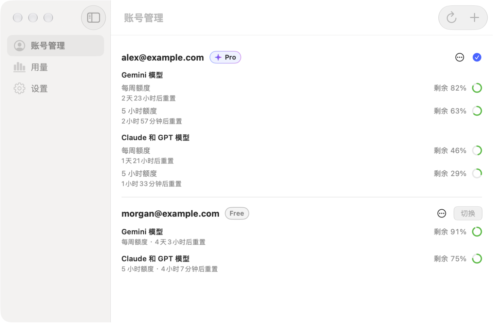
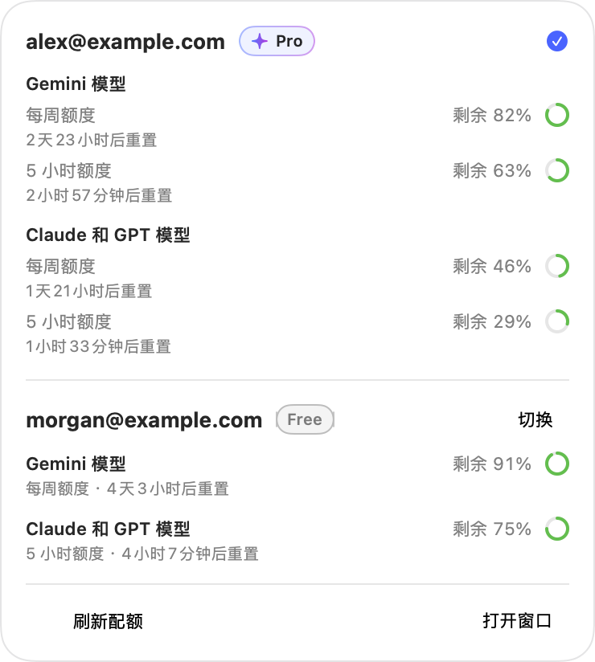
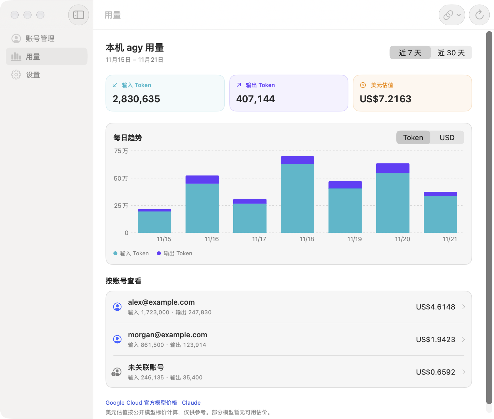

<p align="center">
  
</p>
<h1 align="center">AGY Switcher</h1>
<p align="center">在 macOS 菜单栏切换 Antigravity 和 agy 的 Google 账号，查看配额与本机用量。</p>
<p align="center"><strong>简体中文</strong> · <a href="README.en.md">English</a></p>
<p align="center">
  <a href="#安装">安装</a> ·
  <a href="#快速上手">快速上手</a> ·
  <a href="#界面截图">界面截图</a> ·
  <a href="#从源码构建">从源码构建</a>
</p>

## 安装

需要 **macOS 26 或更新版本**。发布后可在 [GitHub Releases](https://github.com/tyuan511/agy-switcher/releases) 下载适用于 Apple Silicon 和 Intel 的通用安装包 `AGY-Switcher-v*-macOS-universal.dmg`。打开 DMG 后，把 **AGY Switcher** 拖到「应用程序」。也可以[从源码构建](#从源码构建)。

### 应用内更新

正式发布版在启动后及运行期间每 24 小时检查一次 GitHub Release。发现较新的稳定版时，菜单栏会显示更新入口。「设置 → 软件更新」提供手动检查和双语说明。点击「下载并重启」后，应用校验 DMG 的签名和公证，核对包内应用的签名、Bundle ID 和版本，再替换当前应用并重启。请先把应用复制到本机可写的应用程序目录。开发构建跳过应用内更新。

仓库为私有时，在 GitHub 创建只授权 `tyuan511/agy-switcher` 的 fine-grained personal access token，为仓库权限 **Contents** 选择 **Read-only**，然后在设置的「私有仓库访问」保存令牌。令牌仅保存在本机钥匙串。公开仓库可直接检查和下载。 [创建 GitHub 令牌](https://github.com/settings/personal-access-tokens/new)

## 快速上手

1. 打开 AGY Switcher，在「账号管理」右上角点 **＋**，用默认浏览器授权已开通 Antigravity 的个人 Google 账号。重复这一步即可添加多个账号。
2. 在主窗口或菜单栏弹窗中查看当前账号、各模型组的剩余配额和重置倒计时。可以手动刷新，也可以让应用在打开界面时按设定间隔刷新。
3. 点目标账号旁的 **切换**。如果 Antigravity 正在运行，应用会尝试重启它。终端中请重新启动 `agy`，新会话会使用切换后的账号。
4. 打开「用量」，查看近 7 天或 30 天的输入和输出 Token、趋势及美元估值。通过右上角的链条菜单启用 **账号关联** 后，新启动的交互式 `agy` 会话可按登录邮箱统计。无法确认归属的记录会显示在「未关联账号」。

在「设置」中可以切换简体中文和英文、调整外观和配额刷新间隔，并设置登录时启动或隐藏 Dock 图标。

## 界面截图

截图中的邮箱、订阅状态、配额和用量均为虚构示例。

### 账号管理



### 菜单栏



### 用量



## 账号和用量数据

- Google 授权在浏览器里完成。已添加账号的令牌保存于 macOS 钥匙串。切换账号时，应用会更新 Antigravity 和 `agy` 使用的共享钥匙串记录及本地回退凭据。macOS 可能会要求授权访问共享钥匙串。
- 「用量」读取这台 Mac 上的 `agy` SQLite 会话记录。账号关联通过 `agy` 的状态栏记录会话 ID 和登录邮箱，可以随时停用。
- 美元金额是根据 Google Cloud 的全球标准模型价格计算的参考估值，实际费用以账单为准。[Google Cloud 模型定价](https://cloud.google.com/model-garden/pricing)

> [!NOTE]
> 应用面向使用默认 Google 登录的个人账号。配额和账号切换依赖客户端接口及凭据格式，初始适配目标为 Antigravity 2.34.0 和 agy 1.5.12。

## 从源码构建

需要 Xcode 26 或更新版本。在仓库根目录运行单元测试并构建 Debug 版。

```sh
swift test
xcodebuild -project AGYSwitcher.xcodeproj -scheme AGYSwitcher -configuration Debug \
  -destination 'platform=macOS' -derivedDataPath DerivedData \
  CODE_SIGN_IDENTITY=- DEVELOPMENT_TEAM= build
```

构建产物位于 `DerivedData/Build/Products/Debug/AGY Switcher.app`。命令使用临时签名，方便在没有 Developer ID 证书的环境中构建。

<details>
<summary>手动验收</summary>

1. 添加两个已开通 Antigravity 的 Google 账号，检查每个账号的模型组、剩余配额和重置倒计时。
2. 在 Antigravity 运行时从菜单栏切换账号。确认 Antigravity 重启，并在桌面端和新启动的 `agy` 中核对账号。可以用 `agy` 的 `/usage` 对照配额。
3. 关闭主窗口，再从菜单栏打开账号管理，确认当前账号和配额一致。

</details>

<details>
<summary>维护者发布流程</summary>

在 Codex 仓库会话中用 `$release` 预览中英文更新说明。确认后用 `$release 发布` 自动选版本，或用 `$release 发布 0.2.0` 指定版本。

发布流程将中英文说明提交到 `docs/release/`。推送 `vX.Y.Z` 标签后，GitHub Actions 会构建通用 DMG、执行 Developer ID 签名和 Apple 公证，再发布到 GitHub Releases。发布页默认显示英文，并提供简体中文入口。[发布工作流](.github/workflows/release.yml)

首次发布前，在 GitHub 仓库的 **Settings → Secrets and variables → Actions** 中配置以下 repository secrets。

| Secret | 内容 |
| --- | --- |
| `APPLE_CERT_P12` | 包含证书和私钥的 Developer ID Application `.p12`，以 Base64 编码 |
| `APPLE_CERT_PASSWORD` | 导出 `.p12` 时设置的密码 |
| `APPLE_API_KEY_P8` | 用于公证的 App Store Connect 团队 API 密钥，填写 `.p8` 原文 |
| `APPLE_API_KEY_ID` | App Store Connect API Key ID |
| `APPLE_API_ISSUER` | App Store Connect Issuer ID |

</details>

账号与配额界面的交互参考了 [Cockpit Tools](https://github.com/jlcodes99/cockpit-tools)。
